<p align="center">
  
</p>

<p align="center">
  
  
  
  
</p>

<p align="center">
  <b>📖 <a href="#-table-of-contents">Contents</a></b> &nbsp;·&nbsp;
  <b>🧭 <a href="#-how-to-read-this-book">How to Read</a></b> &nbsp;·&nbsp;
  <b>🗂️ <a href="index.md">Bundle Index</a></b> &nbsp;·&nbsp;
  <b>📜 <a href="log.md">Changelog</a></b>
</p>

---

<br>

> _"It works on my machine."_
>
> With Codespaces, it is **always** your machine, and it is the same machine for everyone.

<br>

## 🌌 Prologue

Picture this: you open a repository, click one green button, and **under a minute later** you have a full development environment running in the cloud. The right language versions, tools, extensions and settings are all there. You don't install anything, you don't fight `PATH` variables, and you don't spend your first day on "setup".

That's **GitHub Codespaces**, and this bundle is your guide to it.

You'll start with your first codespace and work up to custom dev containers, prebuilds, secrets, cost control and team-wide workflows. Each chapter is short and practical, and you can try everything as you read.

<br>

## 🎯 Who This Book Is For

<table>
  <tr>
    <td align="center" width="25%">🌱<br><b>Newcomers</b><br><sub>You've never opened a codespace and want a gentle start.</sub></td>
    <td align="center" width="25%">🛠️<br><b>Developers</b><br><sub>You want a reproducible environment for every project.</sub></td>
    <td align="center" width="25%">👩‍🏫<br><b>Educators</b><br><sub>You want every student coding in minutes, not hours.</sub></td>
    <td align="center" width="25%">🏢<br><b>Team Leads</b><br><sub>You want faster onboarding and predictable costs.</sub></td>
  </tr>
</table>

<br>

## 🧭 How to Read This Book

| Path | For you if… | Route |
| :--- | :--- | :--- |
| 🚶 **The Cover-to-Cover Walk** | You're new and want the full story | Read every chapter in order |
| 🏃 **The Sprint** | You need a working codespace _today_ | Read Part I, then skip to what you need |
| 🔎 **The Reference Dive** | You already know the basics | Jump in through the [Bundle Index](index.md) |

### Signposts along the way

Look out for these callouts in each chapter:

> [!TIP]
> **Shortcuts and power-user moves** that save you time.

> [!NOTE]
> **Background and context.** Useful to know, but safe to skip on a first read.

> [!IMPORTANT]
> **Key ideas** that later chapters build on.

> [!WARNING]
> **Pitfalls** that cost time, money or data.

> [!CAUTION]
> **Things you can't undo.** Read these twice.

<br>

## 📖 Table of Contents

> 🖋️ _This book is being written chapter by chapter. New chapters appear here as they're published, and the live listing is always in [chapters/index.md](chapters/index.md)._

<details open>
<summary><b>🟢 Part I: Foundations</b></summary>
<br>

_Coming soon…_

</details>

<br>

## 🧰 What's Inside the Box

```text
github-codespace-knowledge-bundle/
├── 📕 README.md          ← you are here: the cover page
├── 🗂️ index.md           ← OKF root index (okf_version: "0.2")
├── 📜 log.md             ← OKF change log, newest first
├── 📚 chapters/          ← the chapters, in reading order
│   └── index.md
└── 🎨 assets/
    ├── images/           ← diagrams, screenshots, illustrations
    └── code/             ← devcontainer.json samples, scripts, snippets
```

<br>

## 🧬 About the Format

<details>
<summary><b>What is an OKF 0.2 knowledge bundle?</b></summary>
<br>

This repository follows the **Open Knowledge Format (OKF) v0.2**, a plain-Markdown format that both people and AI agents can read.

* 📄 Every chapter is a **concept document**: a Markdown file with YAML frontmatter that declares at least a `type`.
* 🗂️ `index.md` files list the contents of each directory, so readers and agents can go from an overview down to the details.
* 📜 `log.md` records every change, newest first, under ISO `YYYY-MM-DD` dates.
* 🔗 Chapters link to each other with ordinary Markdown links.

So you can read this bundle on GitHub like a book, and an AI assistant can load it as structured knowledge.

</details>

<br>

---

<p align="center">
  <sub>Made with ☁️ and ☕ by <a href="https://github.com/bhagatabhijeet">@bhagatabhijeet</a></sub><br>
  <sub>⭐ If this guide helps you, star the repo so others can find it.</sub>
</p>
