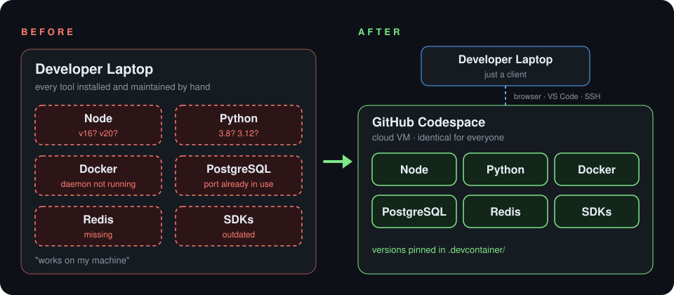
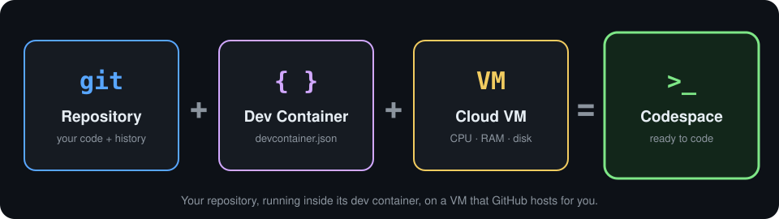
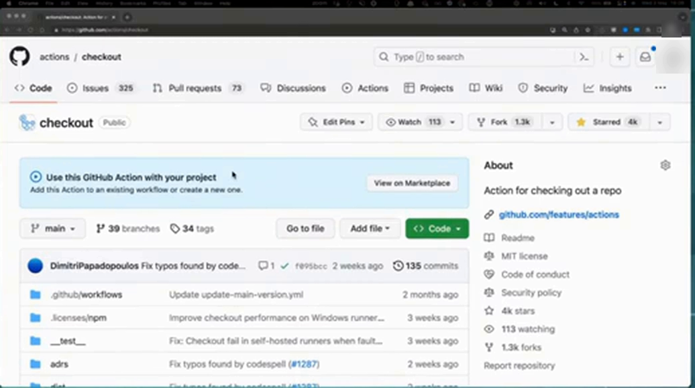
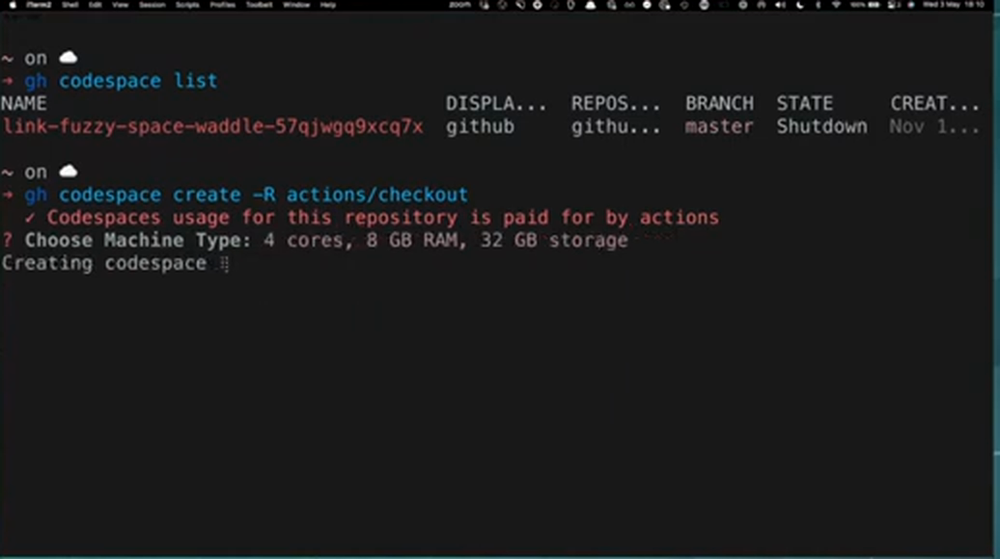
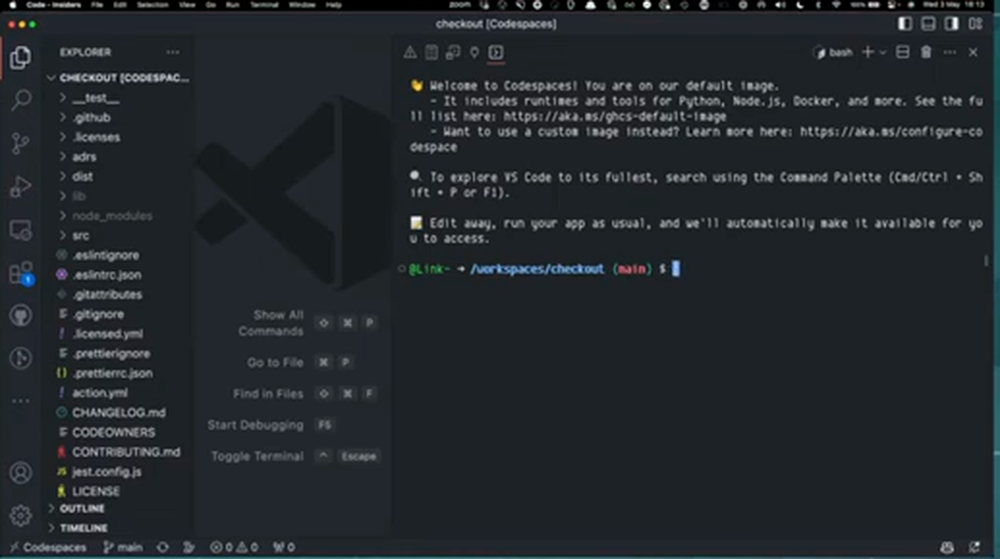

<sub>📕 PART I · FOUNDATIONS</sub>

# ☁️ Chapter 1: What is GitHub Codespaces?

### _Reproducible dev environments: configure once, works for everyone, on any device._

> ⏱️ **8-minute read** · 🎯 **You'll learn:** what a codespace is, why "reproducible" is the key word, and what it looks like to go from a repo to a running environment in seconds.

---

## 🎬 A Tale of Two Mondays

Two developers join the same team on the same Monday. Same laptop, same repo, same coffee. ☕ Only one of them has Codespaces.

<table>
  <tr>
    <th width="50%">😩 Monday <i>without</i> Codespaces</th>
    <th width="50%">😎 Monday <i>with</i> Codespaces</th>
  </tr>
  <tr>
    <td valign="top">
      <b>09:00</b> · Unbox the shiny new laptop ✨<br>
      <b>09:30</b> · Install Git, Node, Python… <i>which versions?</i><br>
      <b>11:00</b> · PostgreSQL won't start. Port 5432 is taken 🔥<br>
      <b>14:00</b> · The setup wiki was last updated two years ago 📜<br>
      <b>16:30</b> · A teammate says <i>"weird, works on my machine"</i> 🤷<br>
      <b>Tuesday</b> · Still no code written
    </td>
    <td valign="top">
      <b>09:00</b> · Open the repo on GitHub<br>
      <b>09:01</b> · Click <b>Code → Codespaces → Create</b> 🖱️<br>
      <b>09:02</b> · Editor open, tools installed, database running ⚡<br>
      <b>09:05</b> · <code>npm test</code> passes. All green ✅<br>
      <b>09:30</b> · First pull request opened 🎉<br>
      <b>Tuesday</b> · Shipping features 🚀
    </td>
  </tr>
</table>

<sub>☝️ A made-up story to illustrate the point, but every developer has lived the left column.</sub>

This chapter is about getting everyone the **right-hand Monday**. It's based on an episode of GitHub's show _GitHub in my day job_, in which host **Christopher Harrison** talks with **Chris** from the Codespaces product team and **Bassem**, who builds GitHub Actions and uses Codespaces every day.[^video]

---

## 🖥️ The Best Day and the Worst Day

Christopher opens the episode with a feeling every developer knows:

> _"The best day in the world is the day that I get a new developer rig, because it's got that new computer smell. And the worst day is the day that I get that new developer rig, because now I know there's a whole bunch of stuff to install."_[^video]

Frameworks, libraries, services, CLI tools. Setting them up can take **hours, sometimes days**. The cost doesn't stop at lost productivity. It also **blocks contribution**: if you want to help on another project in your organization, or on an open-source repo, you have to go through the whole setup process again.

<p align="center">
  
</p>

<details>
<summary>📝 Text version of this diagram</summary>

```text
BEFORE                          AFTER
Developer Laptop                Developer Laptop  (just a client)
├── Node        (v16? v20?)            │  browser · VS Code · SSH
├── Python      (3.8? 3.12?)           ▼
├── Docker      (not running)   GitHub Codespace  (cloud VM)
├── PostgreSQL  (port in use)   ├── Node      ├── PostgreSQL
├── Redis       (missing)       ├── Python    ├── Redis
└── SDKs        (outdated)      └── Docker    └── SDKs
```

</details>

---

## 🎯 Codespaces in a Nutshell

Bassem, a senior engineer who uses Codespaces every day, puts it in one sentence:

> [!IMPORTANT]
> **Codespaces allows you to create a _reproducible_ development environment.**

Unpacking that:

| | What it means |
| :--- | :--- |
| ☁️ **A virtual machine in the cloud** | Your code, tools and running processes live on a VM that GitHub hosts. They don't live on your laptop. |
| 🔌 **Connect with the editor you like** | Use VS Code in the browser or on the desktop, JetBrains IDEs, or a plain SSH terminal. |
| 🔁 **Consistent for everyone** | Every developer gets the same environment, built from the same configuration. |
| ⚡ **Up in seconds** | With prebuilds, a new environment is ready in seconds instead of after hours of setup. |

<p align="center">
  
</p>

Chris, the product manager on the Codespaces team, adds the part that makes it reproducible:

> _"The power of Codespaces is that you have to configure it **only once** and it will work **for everybody on any device**."_[^video]

So you stop writing *"here are the steps to update your development environment"* documents. You change the environment configuration once, and **everyone gets the change right away**.

> [!TIP]
> Christopher's summary: Codespaces takes away the excuse _"…but it works on my machine."_

---

## 🎓 Lessons from the Classroom

Both Bassem and Christopher have taught developers, and they hit the same wall:

* 🧑‍🏫 Bassem spent **three years teaching** at a software engineering bootcamp. The first thing he asked every class to do was spin up a VM with **one specific distribution and specific tool versions**, so nobody lost time on inconsistencies. _"Coding is already quite complex."_
* ⏳ Christopher has seen classes lose **days** just getting people set up: unfamiliar error messages, services, CLI tools. _"Nobody wants to spend five days trying to figure out how to install Python and Postgres."_

### 🤔 "But shouldn't developers learn how to set up their environment?"

Yes, and they still will. Bassem's answer to that objection:

> _"People will learn it anyway. With Codespaces, maybe you bump into an issue at some point and you're going to have to do that deep dive. It's not going to take this learning from you. It's just going to allow you to get to the **first win** that you so need whenever you're starting something new."_[^video]

Christopher's rule: focus on **the current lesson**. For someone starting on a project, the most important thing is **writing that first code**.

---

## 🧅 The Development Environment Is a Product

This is the big mindset shift in the episode. Chris describes how the Codespaces team thinks about it:

> [!NOTE]
> A development environment is a **product you deliver to your developers**. It needs the same maintenance and upkeep as any product, and it keeps evolving along with your code.

* 🏭 A dev environment is a **scaled-down version of production**, so knowing how its pieces fit together is a real skill.
* 👩‍🔬 Codespaces lets a team of **subject-matter experts** own and build the environment centrally.
* 🧅 Individuals can then **peel back the layers** when they get curious, in the order that suits them.

The alternative is what most teams have today. In Chris's words, there are no layers: _"you get the entire onion every time."_ And a new hire, straight out of a bootcamp or school, has to bite into it. 🧅😬

---

## 🔁 How Reproducibility Actually Works

Later in the episode, Chris explains the mechanism behind the promise:

1. 📄 **The `devcontainer.json` is your dev environment as code.** It's checked into the repository, and it's the instruction book for how every codespace comes up.
2. 🌿 **It follows Git, just like your code.** A codespace created from a branch uses *that branch's* dev container configuration. You can change the environment on a feature branch, test it, and merge it. From then on, every new codespace from `main` gets the new setup.
3. ⏪ **Rolling back is just Git.** If an environment change breaks something, you revert or cherry-pick the commit, the same way you would with application code.
4. 👤 **Every codespace is yours alone.** No one shares a single machine. Each developer gets their own codespace from the same configuration, and only its owner can start, stop or connect to it. To pair with someone, you invite them through VS Code Live Share or JetBrains Code With Me.

> [!TIP]
> No dev container in the repo yet? Codespaces still works. You get GitHub's **default image**, which already includes runtimes and tools for Python, Node.js, Docker and more.

---

## 🎬 Seeing It: Repo to Running Environment

Bassem shows the whole flow on a real open-source project: [`actions/checkout`](https://github.com/actions/checkout), the action nearly every GitHub Actions workflow uses.

### 1️⃣ Start from any repository

On any repo you have access to, the green **Code** button opens a **Codespaces** tab where you can create a codespace with one click.

<p align="center">
  
</p>

### 2️⃣ …or from the terminal

Bassem prefers the [GitHub CLI](https://cli.github.com/):

```shell
gh codespace list                        # see the codespaces you already have
gh codespace create -R actions/checkout  # create a new one for this repo
```

The CLI asks for a machine size. Bassem picks **4 cores, 8 GB RAM, 32 GB storage**: _"this is not a massive tool."_

<p align="center">
  
</p>

### 3️⃣ Connect and code

A few seconds later, local VS Code is connected to the codespace. **The editor runs on the laptop, and the code runs in the cloud.** The full project is already there, and the terminal is open in `/workspaces/checkout`.

<p align="center">
  
</p>

What Christopher points out about this moment:

* 🚫 **Nothing was cloned locally.**
* 🚫 **No `node_modules` on the laptop.** _"Every developer knows just how big that can wind up being."_
* 🧹 **No leftover containers taking up gigabytes.** The dev container runs in the cloud, not on your disk.
* 💥 **You can't break your laptop.** Bassem: _"Whatever I install, whatever I delete is contained in this codespace… I can abuse this machine and it will not change anything with my local environment."_
* 🌍 **Latency is low.** Codespaces are geographically distributed, so yours can be created in a region close to you.

The first thing Bassem runs is the test suite, to check that the environment works before he changes anything:

```shell
npm test
```

All green, and he's ready to contribute. He didn't install anything locally or follow a setup guide.

---

## ✨ Where Codespaces Shines

At the end of the episode, the panel names the places it pays off most:

| Shines when… | Why |
| :--- | :--- |
| 🧩 **Setup is painful and fragile** | Python environments, PostgreSQL versions, WebSockets: anything where reproducibility matters to the team's speed. |
| 🤝 **You collaborate** | Shipping the environment with the repo turns it from a private tool into a shared product. |
| 🚀 **New people join** | New hires can make their first change within hours, then learn how everything connects over time. |
| 📚 **Docs go stale** | Setup docs fall behind quickly. A dev container that everyone uses every day stays current, because people fix it with a pull request. |
| 🗑️ **You need to break things** | Delete a broken codespace and create a fresh one. There's nothing to recover. |

---

## 🧠 Key Takeaways

> [!IMPORTANT]
> * ☁️ A **codespace** is a cloud VM running your repo inside its dev container. You connect from your editor of choice.
> * 🔁 Its superpower is **reproducibility**: configure once, works for everybody, on any device.
> * 📄 The **`devcontainer.json`** is the dev environment as code. It's versioned, branched, reviewed and reverted like any code.
> * 🧅 Treat the dev environment as a **product**. Experts build it, and everyone else peels back layers when they're ready.
> * 🏁 The goal is the **first win**: writing code in minutes, not after days of setup.

## 🧪 Try It Yourself

> [!TIP]
> 1. Open any public repo you like on GitHub.
> 2. Click **Code → Codespaces → Create codespace on main**.
> 3. In the terminal, run `git status` and a test command, then look at your laptop's disk. Nothing new is there.
> 4. When you're done, stop or delete the codespace from [github.com/codespaces](https://github.com/codespaces).

---

| ⬅️ Previous | 📖 Contents | Next ➡️ |
| :--- | :---: | ---: |
| [Cover](../README.md) | [All chapters](index.md) | _Coming soon_ |

[^video]: _GitHub Codespaces: Everything you need to know_, from GitHub's **GitHub in my day job** series, recorded 3 May 2023. Quotes are lightly edited from the auto-generated captions. Some details have changed since then (for example, JetBrains support was in beta at the time).
